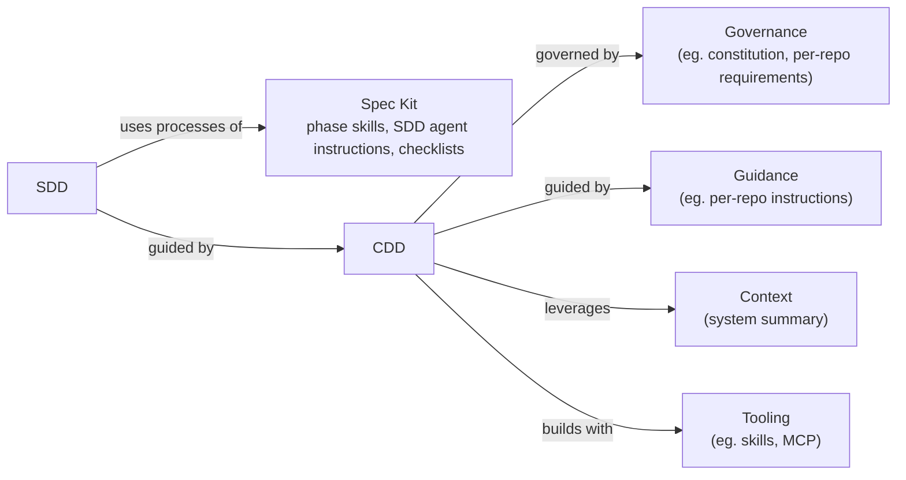
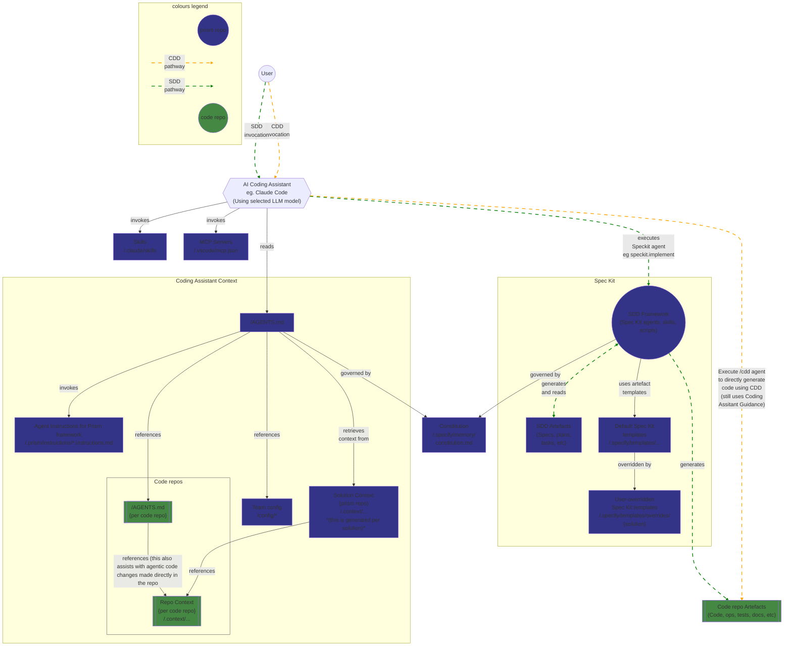

# Nintex Prism

- [Install Prism into team repo](./install/prism-cli.md), or [choose between the CLI and the Claude Code plugin](./install/routes.md)
- [Prism adoption in Nintex](./adoption.md)

## Objectives

Nintex Prism is a process framework aiming to achieve agentic FDLC via:

- **Guidance**: Customisable instructions leading agentic FDLC through specs, design, code, tests and docs.
- **Governance**: Include design and implementation governance, ensuring standards and cross-cutting concerns such as logging, security, observability, accessibility, localisation, etc are maintained.
- **Context**: Provide the coding agents with a comprehensive but lightweight progressive-disclosure context of each code repo.

Additional objective:

- **Flexibility**: Each Nintex team can use parts or all of the process and adapt the process to their needs.
- **Communication**: Both within a team (PM, UX, EM, AO, devs, dev ops, QA and TC) and between affected teams.
- **Cohesion**: Ensure a cohesive solution is designed and implemented across multiple repos and work items.
- **Completeness**: Ensure a checklist of completeness applied to all output artefacts and phases.
- **Shift-left**: Minimal rework by shifting reviews earlier in the process.
- **Tooling**: Custom agents, skills, scripts, MCP servers to assist the process.
- **Velocity**: Faster specification, architecture, technical design, coding, testing, dev ops and documentation.
- **Economy**: Save tokens by providing a summarised system context.
- **History**: A durable repository of feature specification and design, including important decisions.

## Core Concepts

This is achieved using context-driven and spec-driven development:

- **CDD**: Context-driven development (CDD) directs any coding framework with governance, guidance, checklists and tools. This allows free-form agentic coding to an enterprise standard. This is vibe-coding with guardrails.
- **SDD**: Spec-drive development (SDD) builds on top of CDD to enable agentic SDLC. SDD automates the generation of specs, technical plans and work items, allowing smooth generation of a wider feature. This framework currently uses GitHub Spec Kit to run the SDD.

Prism aims to be non-prescriptive while offering a comprehensive agentic framework requiring minimal setup.

### Process

- **[CDD](cdd.md)**: Context-driven development. A defined framework to apply governance, guidance, context and tooling to agentic development. Does not define process. Ideal for smaller, isolated tasks.
- **[SDD](sdd.md)**: Specification-driven development. A process framework where feature intent, validation, design, tasks and downstream implementation artefacts are driven from specifications. Best suited for larger features requiring cross-team, multi-work item or multi-repo coordination.
- **Agent Instructions**: Procedural guidance files in `.prism/instructions/` that define how agents should execute specific SDD workflows (e.g., `speckit-specify.instructions.md`, `speckit-tasks.instructions.md`, `speckit-implement.instructions.md`).
- **Checklists**: Post-stage checklists to be run during after SDD stages.

### Governance

- **Constitution**: Fundamental Nintex software-design principles that govern all framework development. Stored in `/.specify/memory/constitution.md` and defines overarching development values and constraints. This should not generally be different between teams.
- **AGENTS.md**: Root-level agent operating procedures in the prism repo that provide imperative instructions for agent processes, tooling and rules. Each code repo also has its own `AGENTS.md` for repo-specific guidance.

### Context

- **Solution**: The full set of repositories declared in `/.prism/config/repos.yml` — the prism repo plus the code and context repos — forming the governed repo set (both development and context) for a team or feature area. See the [glossary](./glossary.md) for the canonical role and topology definitions.
- **Repo context**: Progressive-disclosure guidance stored in each code repo's `/.context/` directory to help agents follow local architecture, conventions and build/test practices without overwhelming initial context.

### Tooling

- **Agents**: Both Spec Kit and custom Prism agents are used to guide design and implementation workflows.
- **Skills**: Packaged workflows with specialised domain knowledge (e.g., `generate-context-repo`, `create-ado-work-item`) that extend agent capabilities.
- **MCP Servers**: Model Context Protocol server definitions in `/.vscode/mcp.json` that provide additional tooling and integrations.
- **`prism-help`**: A read-only helper agent that answers Prism/SDD process questions and reports where the current feature is in the SDD journey and what to do next. See [Getting help](#getting-help).

## Setup process

Prism CLI [installation](./install/prism-cli.md) and [setup](./install/setup.md)

## Getting help

Not sure how Prism works, or where you are in a feature? Use the read-only `prism-help` agent (`/prism:help` with the Claude plugin, whose command names are listed in the [SDD guide](./sdd.md)). It handles two kinds of request:

- **Process questions** — how Prism and its SDD process work, what a given stage, artefact, agent or role means, and the recommended practice, answered from these `docs/prism/` pages.
- **"Where am I / what next"** — which SDD stage the currently-scoped feature is in, whether any work looks out of sequence, and which agent to run next.

It never changes files or repository state, so it is safe to invoke at any point. It is a helper, not part of the CDD or SDD flow.

## Prism Structure

### Dependency map of Prism solution

Tooling is defined at multiple levels:

- {prism} - setup defined in the prism repo.
- {per code repo} - setup defined inside the code repos of a team's solution. In a `single-repo` topology the same repository holds both the `prism` and `code` roles. See the [glossary](./glossary.md) for role/topology definitions.

> *Note the orange lines indicating the context-driven development (CDD) path.*

### Prism repo components

| Component | Source | Location | Notes |
| --- | --- | --- | --- |
| Constitution | prism | /.specify/memory/ | Fundamental Nintex software-design principles. Generally do not modify. |
| Solution context | user | {sdd repo}/.context/ | Very high level multi-repo architecture. Generate with `/generate-context-prism` after generating code repo contexts (multi-repo topology only). |
| Agent operating procedures | prism | /AGENTS.md, /.prism/instructions/ | Imperative instructions for agent processes, tooling and rules. |
| Agent conduct & phase overrides | user | /.prism/instructions/overrides/ | Team additions to agent conduct and to each SDD phase. Seeded once, never overwritten. |
| Team configuration | user | /.prism/config/ | Team-specific settings. Configure after Prism installation. |
| Skills | prism | /.claude/skills | SDD and CDD skills |
| MCP Servers | prism | /.vscode/mcp.json | MCP server definitions. |
| AI coding assistant | user | /.claude or /.github, etc | Claude Code, GitHub Copilot, or your approved favourite. |
| Spec Kit templates | prism | /.specify/templates/overrides/... | Templates for SDD artefacts - for specs, plans, etc. Override per solution. |
| SDD Framework | Spec Kit (via prism) | /.specify | Spec kit SDD workflows, processes, templates and scripts. Do not modify. |
| SDD artefacts | user (via prism) | /specs/{feature} | Per-feature specs, plans, tasks and contracts. |

### Code repo components

| Component type | Config Owner | Folder | Notes |
| --- | --- | --- | --- |
| Code repo context | Dev team | /.context/ | Progressive disclosure per code repo of architecture, patterns and practices, dependencies and build instructions, etc. Generate with `/generate-context-repo`. |
| Code repo agent operating procedures | Dev team | /AGENTS.md (or similar) | Imperative instructions per code repo for agent processes, providing repo rules, architecture, tooling and processes. Anything that is not universal to all Nintex repos or universal to the Prism process should be referenced from this file. |
